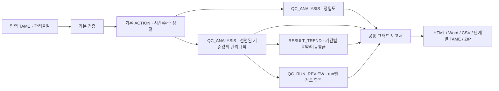

# 기본 기능과 플러그인을 연결하는 QC 예제

이 예제는 관리물질 데이터의 전처리, 정밀도 요약, 관리규칙 확인, 추세 분석과 run별 검토표를 하나의 흐름으로 실행합니다. 정렬·검증·그래프·보고서·처리 이력은 공통 기능을 사용합니다. 업무에 맞게 추가한 `QC_RUN_REVIEW`는 기존 규칙 결과를 요약하는 작은 플러그인입니다.

## 실행 흐름



각 단계는 `source`로 입력을 지정합니다. 정밀도 표를 관리규칙 입력으로 사용하는 대신 두 분석 모두 같은 전처리 결과를 받습니다. 추세와 run 검토는 관리규칙 결과를 받습니다. 그래프와 보고서에는 각 플러그인에 속한 표를 명시적으로 연결하므로 여러 결과가 모두 `main`이라는 이름을 써도 혼동하지 않습니다.

## 웹에서 실행

1. 공통 작업실의 **예제 불러오기**에서 **QC 연결 예제 불러오기**를 누릅니다.
2. META의 `QC_ANALYSIS`에서 검사·관리수준·로트·장비·run·시간의 고정 ID와 기준 평균/SD·단위·유효기간을 확인합니다.
3. **플러그인** 탭에서 자동 선택된 **QC_WORKFLOW**를 실행합니다. 옵션 `{}`는 파일에 선언된 설정을 사용합니다.
4. 분석 화면에서 **플러그인 연결 결과**, 검사별 관리도, 추세, 상세 표를 확인합니다. **HTML 보고서**, **Word 보고서**, **전체 결과 ZIP**을 저장할 수 있습니다.

META의 `[PLUGINS] ENABLED = ["QC_WORKFLOW"]`에 따라 연결에 필요한 세 플러그인도 함께 활성화됩니다. 다른 업무를 추가하려면 [파일별 플러그인 선택](PLUGIN_SELECTION_KO.md)에서 목록을 변경합니다.

이 예제는 인터넷 다운로드 없이 공통 작업실에서 열립니다. 합성 관리물질 24행, 검사 2개, 관리수준 2개, 로트 2개를 포함합니다. 48개 검사 관측 중 하나는 결측입니다. 임상 성능을 입증하는 자료가 아닙니다.

## CLI에서 실행

저장소 루트에서 실행합니다. Word와 PNG 생성에는 `report` 추가 의존성이 필요합니다.

```sh
python -m pip install './tametools[analysis,report]'
tametools run-plugin web/backend/examples/qc_workflow.tame QC_WORKFLOW --option OUTPUT_DIR=qc_report
```

`qc_report`는 새 폴더여야 합니다. 같은 위치를 덮어쓰지 않습니다. `--option REPORT_MAX_ROWS=20`으로 문서에서 표별로 보여줄 행 수를 바꿀 수 있습니다. CSV에는 전체 표가 저장됩니다. 웹에서는 저장 위치를 작업실이 관리합니다.

| 단계 | 연결 기능 | 이 예제의 결과 |
|---|---|---|
| validate → prepare | 기본 검증 + ACTION 정렬 | 원 입력 24행 유지 |
| precision | QC_ANALYSIS / PRECISION | 검사·수준·로트별 8개 집단, 유효 관측 합계 47 |
| rules | QC_ANALYSIS / WESTGARD | 48개 관측별 기준값·z·판정·미평가 상태 |
| trend | RESULT_TREND | 검사·수준·로트·장비·기준값별 기간 요약, 유효 관측 합계 47 |
| review | QC_RUN_REVIEW | 검사별 12개 run씩 24행, 결측도 검토 대상으로 유지 |

정밀도는 검사·관리수준·로트·장비를 분리합니다. `n<2`이면 SD와 CV는 결측이며 이유가 남습니다. 규칙 판정은 이 자료에서 다시 구한 평균/SD가 아니라 META에 선언한 기준값을 사용합니다. 지원 규칙은 `1_3s`, `2_2s`, 동일 run 내 `R_4s`입니다. 기준값 변경과 결측 결과는 연속 run 판정을 끊습니다. `NO_RULE_FLAG`는 지원 규칙이 발동하지 않았다는 뜻이며 자동 승인·결과 보고 허용 판정이 아닙니다.

추세는 기간별 관측 평균과 관측 기간의 이동평균을 제공하는 기술 통계입니다. 결측 기간을 보간하거나 새로운 QC 규칙을 적용하지 않습니다. 관리도에는 결측점을 0으로 그리지 않고 선을 끊어 표시합니다.

## 작은 플러그인을 작성하는 위치

- [QC_RUN_REVIEW](../tametools/src/tametools/plugins/qc_run_review.py): 기존 관측별 판정에서 검사/run별 경고 수·미평가 수·검토 상태만 요약합니다.
- [QC_WORKFLOW](../tametools/src/tametools/plugins/qc_workflow.py): 재사용할 단계와 입력 연결을 지정합니다.
- [PluginWorkflow와 table_output](../tametools/src/tametools/plugin_workflow.py): 입력 복사, 단계 실행, 옵션 병합, 처리 이력, 표 연결을 공통 처리합니다.
- [공통 그래프](../tametools/src/tametools/reporting.py), [공통 보고서 저장](../tametools/src/tametools/report_bundle.py): QC 계산과 독립되어 다른 플러그인에서도 사용합니다.

새 업무 플러그인은 DataFrame 계산 부분과 입력 조건을 작성하고 `table_output(step_name, frame)`을 반환하면 됩니다. 고정 ID와 자료형 태그가 붙은 결과를 후속 단계가 사용할 수 있습니다. 분석할 수치 열은 `result_columns=["value"]`처럼 명시합니다. 그래프는 `chart_spec()`으로 선언하면 웹과 문서가 같은 설정을 사용합니다.

연결 플러그인의 핵심 구조는 다음과 같습니다. 이 코드의 `dataset`에는 예제와 같은 QC 선언이 있어야 합니다.

```python
from tametools.plugin_workflow import PluginWorkflow

flow = PluginWorkflow(dataset)
flow.validate()
flow.action("prepare", "SORT_QC", source="validate")
flow.plugin("precision", "QC_ANALYSIS", source="prepare", options={"MODE": "PRECISION"})
flow.plugin("rules", "QC_ANALYSIS", source="prepare", options={"MODE": "WESTGARD"})
flow.plugin("review", "QC_RUN_REVIEW", source="rules")
output = flow.finish("QC_REPORT", primary="review", title="QC 보고서", output_dir="my_qc_report")
```

각 플러그인의 META 설정을 읽고 명시한 옵션으로 덮어씁니다. 한 분기의 변경은 다른 분기의 입력에 영향을 주지 않습니다. 알 수 없는 입력 단계, 검증 오류 또는 플러그인 실패가 발생하면 그 뒤 단계는 실행하지 않습니다. 외부 플러그인을 호출하는 코드는 `allow_external=True`를 명시해야 하며 기존 신뢰 설정을 따릅니다.

웹에서 공통 보고서를 제공하는 연결 플러그인은 `@register_plugin("NAME", reporting=True)`로 등록하고 `OUTPUT_DIR`을 `flow.finish()`에 전달합니다. 이 계약으로 생성된 HTML·Word·ZIP만 공통 다운로드 영역에 표시합니다.

## 저장 파일

- `report.html`: 이미지를 내장한 단독 열람 보고서.
- `report.docx`, `report_charts/*.png`: 편집 가능한 보고서와 그래프.
- `tables/*.csv`: 단계 이름을 붙인 전체 결과 표.
- `analysis_input.tame`, `results/*.tame`, `result.tame`: 입력·각 단계·최종 결과와 처리 이력.
- `workflow.json`: 단계별 입력 연결과 적용한 옵션.
- `report.zip`: 위 파일을 함께 보관하는 묶음.

CSV와 단계별 TAME로 수치를 다시 확인하고, 저장된 입력으로 동일 흐름을 재실행할 수 있습니다. LOG는 단계별 입력·적용 설정·부모 이력을 보존합니다. 화면이나 문서에서 일부 행만 보더라도 전체 결과 표는 파일에 남습니다.
